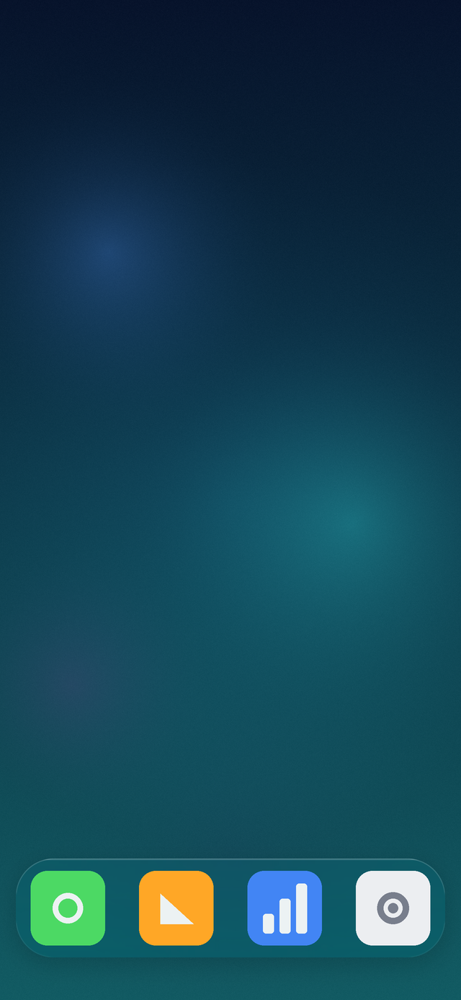
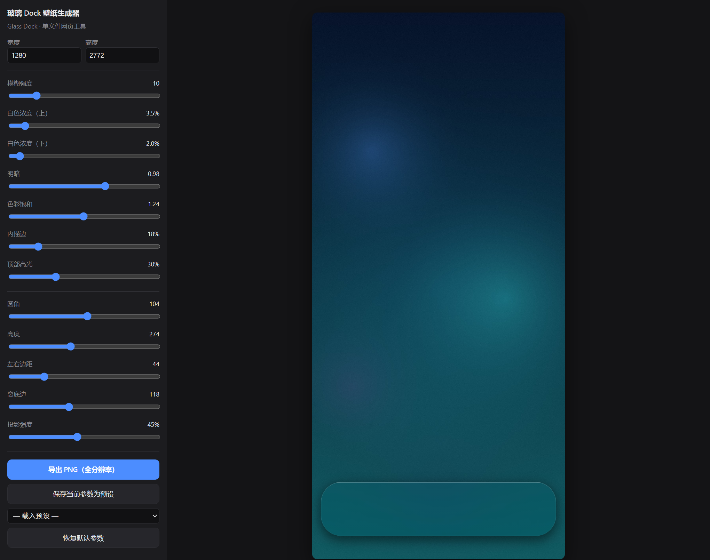

# 玻璃 Dock 壁纸生成器 / Glass Dock Wallpaper Generator

给任意壁纸加上一条 iOS 风格的**毛玻璃 Dock 栏**，实时预览、全分辨率导出。
单文件网页工具，零依赖、零构建、不联网，双击就能用。

为 Redmi K80 Ultra（1280×2772）量过尺寸，其他机型改一下宽高即可。



工具长这样：



---

## 特性

- **单文件**：整个工具就是一个 `index.html`，下载下来双击即可，不需要 Node、不需要装包
- **实时预览**：拖入壁纸立刻出效果，滑杆调参所见即所得
- **全分辨率导出**：预览用低分辨率保证流畅，导出时按原始尺寸重算，不糊
- **真实玻璃质感**：不是简单叠一层半透明白，而是模糊 + 饱和度补偿 + 竖直蒙版 + 内描边 + 顶部高光 + 投影
- **参数预设**：调好的组合可命名保存（localStorage），下次直接调用
- **一键恢复默认**：参数调飞了不用慌

## 快速开始

1. 下载 [`index.html`](index.html)
2. 双击，用 **Chrome / Edge / Firefox** 打开
3. 拖入你的壁纸（或点击选择文件）
4. 调滑杆 → 点「导出 PNG」

在线 Demo：`https://<你的用户名>.github.io/RedmiK80Ultra-wallpaper-dock/`

## 参数说明

| 参数 | 作用 | 默认 |
|---|---|---|
| 模糊 | 背景高斯模糊半径，越大越"磨砂" | 10 |
| 白度 上 / 下 | 蒙版顶部、底部的白色浓度（%） | 35 / 20 |
| 明暗 | 玻璃区域的整体明度（%） | 98 |
| 饱和度 | 透过玻璃看到的颜色浓度（%） | 124 |
| 内描边 | 边缘 1px 高光的强度（%） | 18 |
| 顶部高光 | 顶部一条细亮线的强度（%） | 30 |
| 圆角 | Dock 圆角半径（px） | 104 |
| 高度 | Dock 高度（px） | 274 |
| 左右边距 | Dock 距屏幕左右边缘（px） | 44 |
| 离底边 | Dock 距屏幕底部（px） | 118 |
| 投影 | Dock 下方投影强度（%） | 45 |

> 调参思路：先定**几何**（高度、离底边、圆角、边距），让它和启动器的图标对齐；再调**材质**（模糊、白度、明暗），最后加**细节**（内描边、高光、投影）。

## 换机型怎么调

工具默认 1280×2772，是 Redmi K80 Ultra 的物理分辨率。换机器时只需要改三件事：

1. 顶部宽高输入框改成你的分辨率
2. **高度 / 离底边 / 左右边距**：截图后用任意像素工具量一下启动器图标条的上下左右边界
3. **圆角**：一般取高度的 0.38 倍左右（274 × 0.38 ≈ 104）

K80 Ultra 上的实测值：Dock 矩形 `x 44–1236, y 2380–2654`，圆角 104，图标 207×207 位于 `y 2414–2620`（上下各留白 34）。

## 玻璃效果是怎么做的

1. 把壁纸按 Dock 区域裁出来，做**高斯模糊**
2. 往灰度方向**拉回一点饱和度**，再压一点明度（否则玻璃会偏灰偏亮）
3. 叠一层**竖直渐变的白色蒙版**（顶部 3.5% → 底部 2.0%），制造"上方受光"的错觉
4. 沿圆角边缘做**内描边**，且上亮下暗（0.25 衰减），模拟玻璃厚度
5. 顶部 6px **高光条**，从 30% 渐变到 0
6. 整体下方加**投影**（模糊 26、下移 10），让 Dock 浮起来

## 浏览器兼容

| 浏览器 | 状态 |
|---|---|
| Chrome / Edge | 完整支持 |
| Firefox | 完整支持 |
| Safari | `CanvasRenderingContext2D.filter` 支持较晚，未做降级实现，不保证效果 |

## 目录结构

```
index.html              # 全部代码，单文件
demo/
  demo-wallpaper.png    # 示例壁纸（自生成，可自由使用）
  example-result.png    # 示例输出
docs/
  preview-small.png     # README 用缩略图
  dock-closeup.png      # 局部放大
  tool.png              # 工具界面截图
LICENSE                 # MIT
```

## 版权说明

- 代码与仓库内的示例图（`demo/`、`docs/`）均为本项目自制，可自由使用
- 「Redmi」为小米公司商标，本项目**与小米公司无关**，名称仅用于说明适配机型
- 玻璃拟态（Glassmorphism）是一种通用视觉风格，不受商标保护

## License

[MIT](LICENSE) © 2026 RedmiK80Ultra-wallpaper-dock contributors

---

## English

A single-file web tool that adds an iOS-style **frosted glass dock** to any wallpaper and exports at full resolution.

No dependencies, no build step, no network — just download `index.html` and open it in Chrome, Edge, or Firefox.

Defaults are measured for Redmi K80 Ultra (1280×2772). For other devices, change the width/height inputs and adjust dock height, bottom margin, and corner radius.

The glass is built from a real Gaussian blur plus saturation compensation, a vertical white veil, an inner rim light (brighter on top), a specular highlight, and a drop shadow — not just a translucent white rectangle.

Licensed under the MIT License. "Redmi" is a trademark of Xiaomi; this project is not affiliated with Xiaomi.
